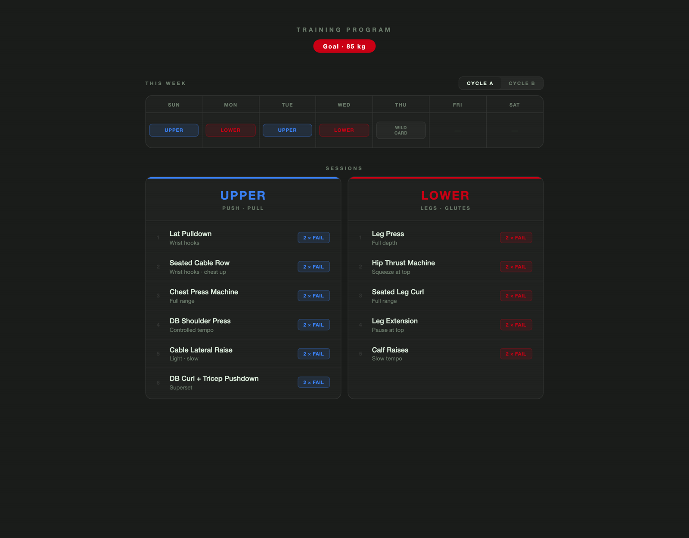
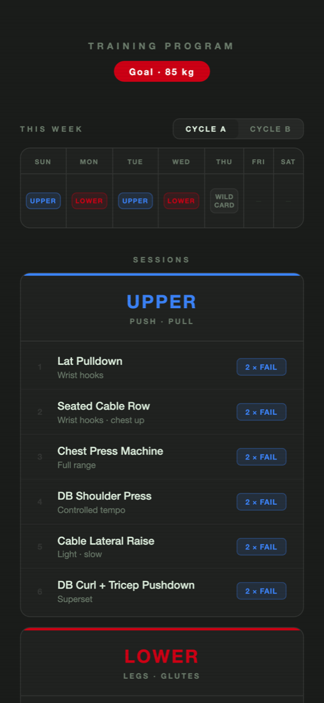

# Workout Tracker

**My personal training program as a clean, glanceable web page.**

[**Open it**](https://yousefabuyaseen.github.io/workout-tracker/) · [Portfolio](https://www.yousef.studio/)

## What it does

- **Two rotating cycles:** *Cycle A* (Upper, Lower, Upper, Lower, Wildcard, Rest, Rest) and *Cycle B* (Upper, Lower,
  Wildcard, then rest), shown as a week grid you can switch between.
- **Session cards** for **Upper** (push · pull) and **Lower** (legs · glutes), listing each exercise, a coaching cue
  (*"wrist hooks · chest up"*, *"squeeze at top"*) and the set scheme.
- **Goal badge** for the target weight, always at the top.
- **Phone first:** it's built to check between sets.

## Run it

One file with no dependencies. Open `index.html`, or add the GitHub Pages link to your phone's home screen.
